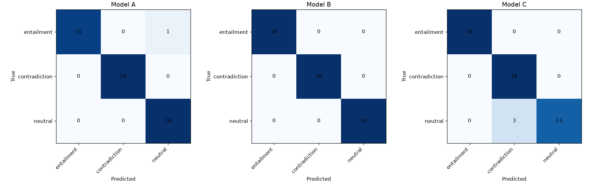

# 06 - Natural Language Inference: Premise and Hypothesis

## Context

Imagine an AI assistant answering customer questions from user manuals and enterprise documentation. Before trusting a generated answer, you need to know whether it is supported by the documentation, contradicts it, or goes beyond what the documentation says.

This challenge moves beyond single-text classification. Instead of assigning a topic to one document, the system must judge the logical relationship between two texts: a premise (the documentation) and a hypothesis (the generated claim).

> Premise: "The platform allows exporting reports in PDF, but not in Excel."
>
> - **Entailment** — "The platform allows exporting PDF documents." The premise supports the hypothesis.
> - **Contradiction** — "The platform allows exporting reports in Excel." The hypothesis contradicts the premise.
> - **Neutral** — "The platform allows scheduling automatic exports." There is not enough information to decide.

The distinction between contradiction and missing information is essential: a statement that does not appear in the documentation is not necessarily false.

## Mission

Compare three approaches of increasing complexity for Natural Language Inference (NLI) on Spanish premise-hypothesis pairs:

1. **Model A — Lexical similarity**: a Jaccard-similarity baseline with thresholds.
2. **Model B — TF-IDF + Logistic Regression**: a supervised classifier over a joint representation of the pair.
3. **Model C — Multilingual Transformer**: a pretrained, NLI-fine-tuned multilingual transformer used for inference.

The challenge tests not only text classification, but semantic relationships between pairs of texts and generalization to new entities and contexts.

## Learning Objectives

1. Build a reproducible synthetic Spanish dataset of premise-hypothesis pairs with balanced labels.
2. Implement a lexical NLI baseline using token overlap and negation cues.
3. Train and evaluate a supervised TF-IDF + Logistic Regression classifier on paired texts.
4. Use a pretrained multilingual transformer for zero-shot/fine-tuned NLI inference.
5. Evaluate with accuracy, macro-F1, classification reports and confusion matrices.
6. Analyze generalization to unseen templates, entities and paraphrases.
7. Apply NLI to a small RAG-style verification of generated answers.

## Theoretical Foundation

**Natural Language Inference** assigns one of three labels to a (premise, hypothesis) pair:

- **Entailment**: the hypothesis follows from the premise.
- **Contradiction**: the hypothesis is incompatible with the premise.
- **Neutral**: the premise neither entails nor contradicts the hypothesis.

Model A relies on surface overlap. Jaccard similarity between token sets is a strong cue for entailment, but it cannot by itself detect contradiction, so negation and conflicting-entity checks are added.

Model B reuses the TF-IDF idea from the text-classification challenge, but over the pair instead of a single document. A joint vector (for example `premise [SEP] hypothesis`) lets a linear classifier learn lexical patterns associated with each relation.

Model C uses a multilingual transformer already fine-tuned on NLI (XNLI-style data). Cross-attention between premise and hypothesis captures semantic composition, paraphrase and negation far better than lexical overlap, which is why it is the recommended approach for RAG verification.

A random split mixes paraphrases of the same template across train and test. A `GroupShuffleSplit` keyed by `template_id` keeps every template on one side of the split, giving a more honest measure of generalization.

## Experiment Flow

1. **Data Generation**: reproducible synthetic Spanish dataset of premise-hypothesis pairs from templates, with `template_id` and entity metadata.
2. **Model A**: Jaccard similarity plus thresholds and negation/entity-conflict rules.
3. **Model B**: TF-IDF over the joint pair + `LogisticRegression`.
4. **Model C**: pretrained multilingual transformer for NLI inference in batches.
5. **Evaluation**: accuracy, macro-F1, classification reports and confusion matrices for all three models.
6. **Generalization Analysis**: group-based split by template and hand-written out-of-template pairs.
7. **RAG Verification Demo**: classify each claim of a generated answer against the most relevant documentation premise.

## Reusable RAG Verifier

The solution also exposes a reusable helper:

```python
verificar_respuesta(contexto, respuesta, threshold=0.80) -> dict
```

It splits the answer into individual claims, retrieves the most relevant evidence for each claim, runs NLI, and returns the global relation, model scores, and an operational decision (`aceptar`, `revisar` or `abstenerse`).

## Results

The script trains and evaluates all three models on the same partitions and prints:

- Accuracy and macro-F1 for Models A, B and C.
- Per-class precision/recall and confusion matrices.
- The comparison between random and group-based splits.
- Predictions on hand-written out-of-template pairs.
- A small RAG verification table (`supported`, `contradicted`, `insufficient_evidence`).

Artifacts are saved under `results/`:



- `results/metrics.csv`
- `results/metrics_groups.csv`
- `results/confusion_matrices.png`
- `results/predictions.csv`
- `results/verification_demo.csv`

On this deliberately simple dataset, Models A and B can reach very high scores by exploiting lexical shortcuts (explicit negations and repeated formats). Model C is less tied to those surface cues and is preferred for semantic verification, even when its raw score is lower. Model A remains the weakest approach for neutral and contradiction cases that are not marked by simple overlap.

## Requirements

Dependencies are listed in the root `requirements.txt`. This challenge additionally uses `transformers`, `torch`, `sentencepiece` and `accelerate`:

```bash
pip install -r ../requirements.txt
pip install transformers torch sentencepiece accelerate
```

## Usage

The complete implementation is in `solution.py`. Run it with:

```bash
python solution.py
```

The script prints the evaluation of the three models, the split comparison, out-of-template predictions and the RAG verification demo, then saves the metric CSVs, confusion matrices and prediction files.

## Conclusions and Limitations

- Lexical overlap is a useful but shallow signal: it can suggest entailment, but it struggles with contradiction and with information that is simply absent.
- TF-IDF + Logistic Regression improves on the baseline when training data is available, but still depends heavily on the vocabulary of the templates.
- The multilingual transformer captures semantic relationships (paraphrase, negation, entity conflict) and generalizes better to unseen templates.
- A high score on a random split does not guarantee generalization; the group-based split is the honest protocol for this synthetic dataset.
- The dataset is small, synthetic and limited to one domain. Real deployment would require a larger and more varied corpus, human review for low-confidence predictions and careful handling of domain-specific terminology.
- Neutral must not be confused with contradiction: absence of evidence is not evidence of absence.