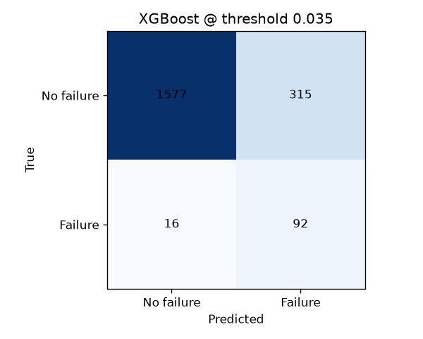

# 07 - Cost-Sensitive Maintenance Prediction

## Context

An industrial company monitors machinery with sensors and wants to anticipate failures in order to perform preventive maintenance. Only a small proportion of observations correspond to real failures, and prediction errors have different economic consequences:

- **False negative (5,000 €)**: a real failure is not detected.
- **False positive (200 €)**: an unnecessary intervention is performed.

A model with high accuracy can still be economically disastrous if it misses failures. This challenge optimizes the business cost of decisions, not only statistical metrics.

## Mission

Compare Logistic Regression, Random Forest and XGBoost on an imbalanced synthetic maintenance dataset. Select the model by cross-validation, calibrate probabilities, tune the decision threshold on a validation set, and evaluate once on a held-out test set.

## Learning Objectives

1. Handle imbalanced classification (≈5% positives).
2. Use stratified train/validation/test splits.
3. Compare models with cross-validation and Average Precision.
4. Calibrate probabilistic predictions and measure Brier Score.
5. Tune the decision threshold to minimize business cost.
6. Avoid data leakage across selection, calibration, threshold tuning and final evaluation.

## Theoretical Foundation

With imbalanced data, accuracy is misleading. **Average Precision** summarizes the precision-recall trade-off and is more informative than ROC-AUC when positives are rare. **Brier Score** measures the reliability of predicted probabilities. **Calibration** aligns predicted probabilities with observed frequencies. **Threshold tuning** converts probabilities into decisions according to asymmetric costs: missing a failure is 25 times more expensive than a false alarm.

## Experiment Flow

1. **Data Generation**: 10,000 samples, 12 features, ≈5% positives, with label noise.
2. **Split**: 6,000 train / 2,000 validation / 2,000 test.
3. **Model Selection**: 5-fold stratified cross-validation by Average Precision.
4. **Validation**: fit all models, evaluate PR-AUC, ROC-AUC, Brier and cost at threshold 0.5.
5. **Calibration**: sigmoid calibration of the selected model.
6. **Threshold Tuning**: compare the theoretical cost-optimal threshold with the empirical threshold that minimizes validation cost.
7. **Test Evaluation**: one final evaluation with the fixed model and threshold.

## Results

Artifacts are saved under `results/`:



- `results/metrics.csv`
- `results/costs.csv`
- `results/calibration_comparison.csv` (original vs. sigmoid-calibrated Brier Score and PR-AUC)
- `results/thresholds.csv` (empirical and theoretical thresholds)
- `results/calibration_comparison.csv` (original vs. sigmoid-calibrated Brier Score and PR-AUC)
- `results/cv_results.csv`
- `results/validation_results.csv`
- `results/pr_curve.png`
- `results/calibration.png`
- `results/cost_vs_threshold.png`
- `results/confusion_matrix.png`

The tuned threshold substantially reduces business cost compared with predicting all negatives or using a 0.5 threshold.

## Requirements

```bash
pip install -r ../requirements.txt
```

XGBoost is required in addition to the base dependencies.

## Usage

```bash
python solution.py
```

## Conclusions and Limitations

- Accuracy alone is not enough for imbalanced, cost-sensitive problems.
- Cross-validation is used for model selection, validation for threshold tuning, and test only for final evaluation.
- Calibration improves the reliability of probabilities used for thresholding.
- The dataset is synthetic and does not represent a real physical machine.
- The calibrated model does not need to beat the original in every metric; calibration and threshold optimization target different objectives, and the final goal is to reduce business cost.
- Brier Score should be interpreted together with class prevalence; it combines calibration and predictive ability.