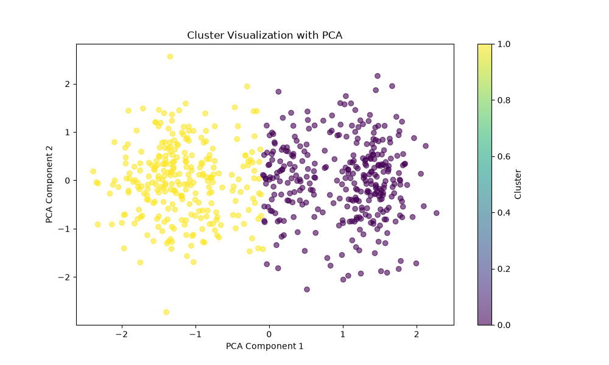
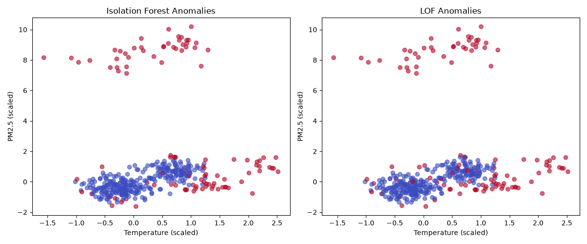
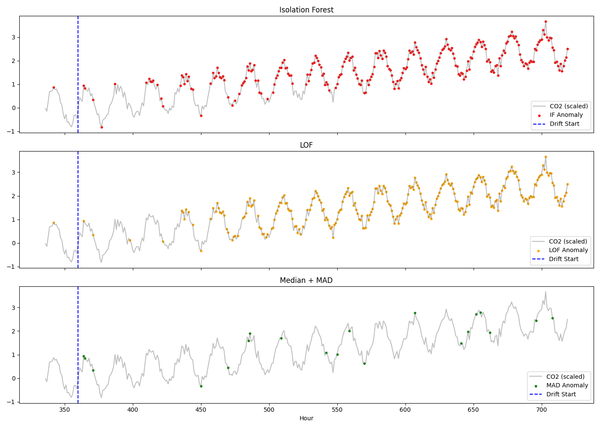

# AI-Python-Challenges


A collection of Python-based AI challenges focused on unsupervised learning, anomaly detection, text classification, and informed search.

## Challenges

### 01-territorial-clustering
Clustering of territorial profiles using K-Means. Discover patterns in geographic data to identify distinct territorial segments.

### 02-anomaly-detection
Anomaly detection in environmental sensors using Isolation Forest and Local Outlier Factor (LOF). Includes:
- Synthetic sensor data generation (temperature, humidity, PM2.5, CO₂)
- Unsupervised anomaly detection (global and local anomalies)
- Time series extension with gradual drift detection
- Comparison of IF, LOF, and Median+MAD approaches

### 03-text-classification
Automatic classification of citizen incident messages (lighting, cleaning, transport, water supply) using Bag of Words (BoW) and TF-IDF with LogisticRegression. Includes:
- Synthetic reproducible Spanish dataset of citizen messages
- Text representation with unigrams and bigrams
- Comparison of BoW vs TF-IDF classifiers on the same partitions
- Evaluation via macro-F1, confusion matrices, and per-class errors
- Analysis of generalization limits on unseen expressions

### 04-pathfinding-algorithms
Informed search and route planning on a synthetic grid. A maintenance vehicle travels from its base to an incident through a road network with blocked roads and variable circulation costs. Includes:
- Reproducible synthetic 7x7 grid with obstacles and variable movement costs
- From-scratch implementation of Dijkstra (uninformed) and A* (informed) using a priority queue
- Admissible and consistent heuristic design
- Comparison of path cost and number of explored nodes
- Analysis of when a heuristic improves efficiency
- Dynamic replanning simulation with 10 successive blockages
- D* Lite investigation for incremental replanning
## Installation

1. Clone the repository:
```bash
git clone https://github.com/SeleneGonzalezCurbelo/AI-Python-Challenges.git
cd AI-Python-Challenges
```

2. Install dependencies:
```bash
pip install -r requirements.txt
```

## Usage

### Challenge 01: Territorial Clustering
```bash
cd 01-territorial-clustering
python solution.py
```

### Challenge 02: Anomaly Detection
```bash
cd 02-anomaly-detection
python solution.py
python solution_timeseries.py
```

### Challenge 03: Text Classification
```bash
cd 03-text-classification
python solution.py
```

### Challenge 04: Pathfinding Algorithms
```bash
cd 04-pathfinding-algorithms
python solution.py
```
## Screenshots

### Challenge 01: Territorial Clustering


### Challenge 02: Anomaly Detection



## Roadmap

- [x] Challenge 01: Territorial Clustering (K-Means)
- [x] Challenge 02: Anomaly Detection (Isolation Forest, LOF)
- [X] Challenge 03: Text Classification (BoW, TF-IDF)
- [ ] Challenge 04: Pathfinding Algorithms (Dijkstra, A*)
- [ ] Next proposed challenge: 05-neural-network-from-scratch - implement a multilayer neural network using only NumPy, including forward propagation, backpropagation, gradient descent, and numerical gradient checking.
## Contributing

1. Fork the repository
2. Create a feature branch (`git checkout -b feature/new-challenge`)
3. Commit your changes (`git commit -m 'Add new challenge'`)
4. Push to the branch (`git push origin feature/new-challenge`)
5. Open a Pull Request

## Requirements
```bash
pip install -r requirements.txt
```

## Files to Upload to GitHub
```
AI-Python-Challenges/
├── README.md
├── requirements.txt
├── 01-territorial-clustering/
│   ├── README.md
│   ├── solution.py
│   └── results/
│       └── clusters_plot.png
├── 02-anomaly-detection/
│   ├── README.md
│   ├── solution.py
│   ├── solution_timeseries.py
│   └── results/
│       ├── anomalies_plot.png
│       ├── results.csv
│       ├── timeseries_plot.png
│       └── timeseries_results.csv
├── 03-text-classification/
│   ├── README.md
│   ├── solution.py
│   └── results/
├── 04-pathfinding-algorithms/
│   ├── README.md
│   ├── solution.py
│   └── results/
```

**Exclude from upload:**
- `__pycache__/` directories
- Any `.pyc` files
