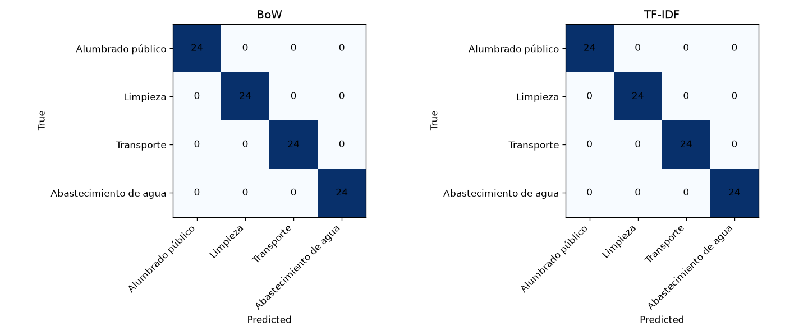
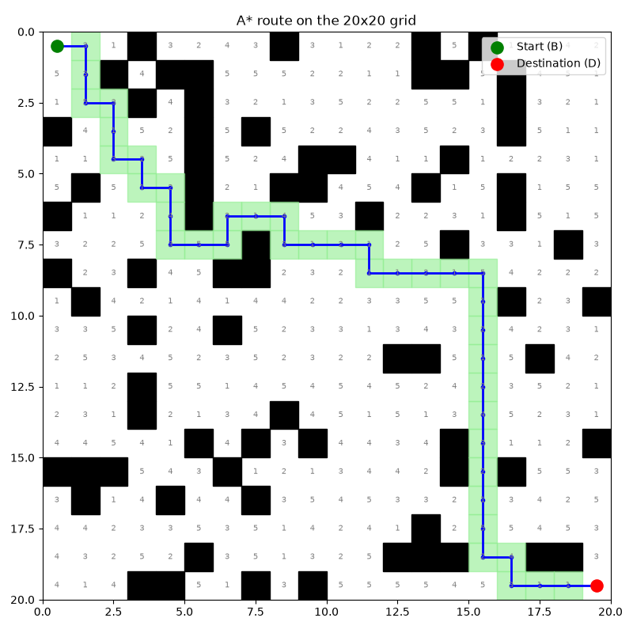
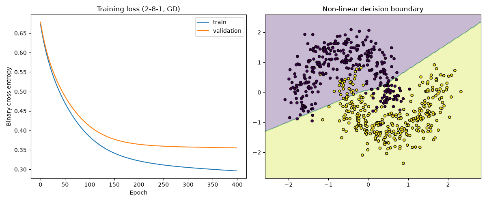
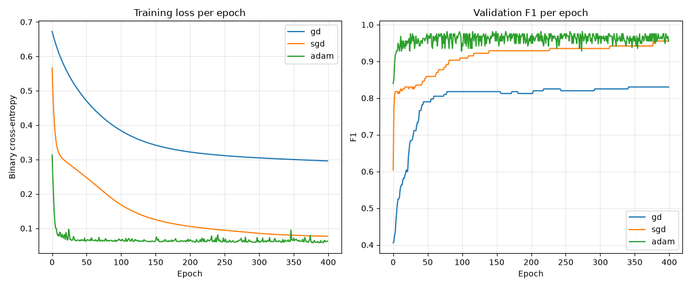
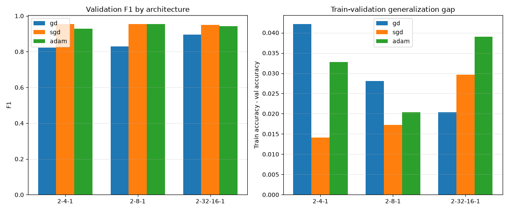

# AI-Python-Challenges


A collection of Python-based AI challenges covering unsupervised learning, anomaly detection, text classification, informed search, and neural networks built from scratch.

Developed and tested with **Python 3.11.18** (NumPy 2.4.6, pandas 3.1.1, Matplotlib 3.11.2, scikit-learn 1.9.1). Every script uses `SEED = 42`, so the numbers below are reproducible.

## Results Snapshot

| Challenge | Headline result |
| :--- | :--- |
| 01 - Territorial Clustering | `k = 2` selected by silhouette (0.3862); bootstrap ARI 0.9463 ± 0.0436 |
| 02 - Anomaly Detection | Isolation Forest F1 0.8602, LOF F1 0.8205; drift detected after 4 h |
| 03 - Text Classification | In-template macro-F1 1.0000 both models; group-split drops to 0.4453 / 0.2229 |
| 04 - Pathfinding | A* matches Dijkstra's cost (98) with 309 vs 322 explored nodes; replanning 568 vs 784 |
| 05 - Neural Network From Scratch | Test F1 up to 0.9901; SGD/Adam converge faster than full-batch GD; gradient error < 1e-8 |
| 06 - Natural Language Inference | Three approaches (Jaccard baseline, TF-IDF + Logistic Regression, multilingual transformer) for premise-hypothesis entailment, contradiction and neutral |
| 07 - Predictive Model Comparison | Imbalanced failure prediction with CV model selection, probability calibration, threshold tuning and business-cost evaluation |

## Challenges

### 01-territorial-clustering
Clustering of territorial profiles using K-Means. Discover patterns in geographic data to identify distinct territorial segments. Includes:
- Log transformation and robust scaling of skewed variables
- K-Means for k between 2 and 8, selected by silhouette score
- Bootstrap stability analysis with Adjusted Rand Index (30 resamples)
- Cluster interpretation and PCA visualization

### 02-anomaly-detection
Anomaly detection in environmental sensors using Isolation Forest and Local Outlier Factor (LOF). Includes:
- Synthetic sensor data generation (temperature, humidity, PM2.5, CO₂)
- Unsupervised anomaly detection (global and local anomalies)
- Time series extension with gradual drift detection
- Comparison of IF, LOF, and Median+MAD approaches

### 03-text-classification
Automatic classification of citizen incident messages (lighting, cleaning, transport, water supply) using Bag of Words (BoW) and TF-IDF with LogisticRegression. Includes:
- Synthetic reproducible Spanish dataset of citizen messages
- Text representation with unigrams and bigrams
- Comparison of BoW vs TF-IDF classifiers on the same partitions
- Evaluation via macro-F1, confusion matrices, and per-class errors
- Analysis of generalization limits on unseen expressions and templates

### 04-pathfinding-algorithms
Informed search and route planning on a synthetic grid. A maintenance vehicle travels from its base to an incident through a road network with blocked roads and variable circulation costs. Includes:
- Reproducible synthetic 20x20 grid with obstacles and variable movement costs
- From-scratch implementation of Dijkstra (uninformed) and A* (informed) using a priority queue
- Admissible and consistent heuristic design
- Comparison of path cost and number of explored nodes
- Dynamic replanning simulation with 10 successive blockages
- D* Lite investigation for incremental replanning

### 05-neural-network-from-scratch
Implementation of a multilayer perceptron (MLP) from scratch using only NumPy to solve a non-linear binary classification problem (`make_moons`). Includes:
- Manual forward propagation with ReLU and Sigmoid activation functions
- Binary cross-entropy loss computation with numerical stability
- Analytical backpropagation and gradient descent optimization
- Full-batch GD, mini-batch SGD and Adam compared under identical initialization
- Architecture study (`2-4-1`, `2-8-1`, `2-32-16-1`) and generalization-gap analysis
- Non-linear decision boundary visualization and numerical gradient checking

### 06-natural-language-inference
Natural Language Inference (NLI) over Spanish premise-hypothesis pairs, classifying each pair as entailment, contradiction or neutral. Includes:
- Reproducible synthetic dataset of documentation-style premise-hypothesis pairs
- Model A: Jaccard lexical similarity baseline with thresholds and negation cues
- Model B: TF-IDF + Logistic Regression over a joint representation of the pair
- Model C: pretrained multilingual transformer fine-tuned for NLI
- Evaluation with accuracy, macro-F1, confusion matrices and per-class reports
- Group-based split by template and hand-written out-of-template pairs for generalization
- RAG-style verification demo for generated answers against documentation premises

### 07-predictive-model-comparison
Cost-sensitive prediction of rare industrial failures using an imbalanced synthetic sensor dataset. Includes:
- 10,000 observations with approximately 5% positive cases
- Logistic Regression, Random Forest and XGBoost with the specified initial parameters
- Stratified 6,000 / 2,000 / 2,000 train, validation and test split
- 5-fold cross-validation by Average Precision for model selection
- Sigmoid calibration of the selected model
- Validation threshold tuning to minimize business cost (5,000 € FN, 200 € FP)
- Final test evaluation with PR curve, calibration curve and confusion matrix

## Installation

1. Clone the repository:
```bash
git clone https://github.com/SeleneGonzalezCurbelo/AI-Python-Challenges.git
cd AI-Python-Challenges
```

2. Install dependencies (a virtual environment is recommended):
```bash
python -m venv .venv
source .venv/bin/activate      # Windows: .venv\Scripts\activate
pip install -r requirements.txt
```

## Usage

Each challenge is self-contained. Run its script from the repository root:

```bash
cd 01-territorial-clustering && python solution.py
cd ../02-anomaly-detection && python solution.py && python solution_timeseries.py
cd ../03-text-classification && python solution.py
cd ../04-pathfinding-algorithms && python solution.py
cd ../05-neural-network-from-scratch && python solution.py
cd ../06-natural-language-inference && python solution.py
cd ../07-predictive-model-comparison && python solution.py
```

All scripts resolve their `results/` directory relative to their own file, so they also work when invoked from another working directory. Detailed instructions are in each challenge's README.

## Screenshots

### Challenge 01: Territorial Clustering


### Challenge 02: Anomaly Detection


### Challenge 03: Text Classification


### Challenge 04: Pathfinding Algorithms


### Challenge 05: Neural Network From Scratch


### Challenge 06: Natural Language Inference




## Roadmap

- [x] Challenge 01: Territorial Clustering (K-Means)
- [x] Challenge 02: Anomaly Detection (Isolation Forest, LOF)
- [x] Challenge 03: Text Classification (BoW, TF-IDF)
- [x] Challenge 04: Pathfinding Algorithms (Dijkstra, A*)
- [x] Challenge 05: Neural Network From Scratch (MLP, NumPy, Backprop)
- [ ] Challenge 06: Natural Language Inference (Jaccard, TF-IDF, Multilingual Transformer)
- [ ] Challenge 07: Cost-Sensitive Maintenance (Logistic Regression, Random Forest, XGBoost)

## Repository Structure

```
AI-Python-Challenges/
├── .gitattributes
├── .gitignore
├── LICENSE
├── README.md
├── requirements.txt
├── 01-territorial-clustering/
│   ├── README.md
│   ├── solution.py
│   └── results/
│       └── clusters_plot.png
├── 02-anomaly-detection/
│   ├── README.md
│   ├── solution.py
│   ├── solution_timeseries.py
│   └── results/
│       ├── anomalies_plot.png
│       ├── results.csv
│       ├── timeseries_plot.png
│       └── timeseries_results.csv
├── 03-text-classification/
│   ├── README.md
│   ├── solution.py
│   └── results/
│       ├── confusion_matrices.png
│       ├── metrics.csv
│       └── metrics_groups.csv
├── 04-pathfinding-algorithms/
│   ├── README.md
│   ├── solution.py
│   └── results/
│       └── route_plot.png
└── 05-neural-network-from-scratch/
    ├── README.md
    ├── solution.py
    └── results/
        ├── architecture_comparison.png
        ├── experiment_summary.csv
        ├── optimizer_comparison.png
        ├── optimizer_history.csv
        └── training_results.png
└── 06-natural-language-inference/
    ├── README.md
    ├── solution.py
    └── results/
        ├── confusion_matrices.png
        ├── metrics.csv
        ├── metrics_groups.csv
        ├── predictions.csv
        └── verification_demo.csv
└── 07-predictive-model-comparison/
    ├── README.md
    ├── solution.py
    └── results/
        ├── calibration.png
        ├── confusion_matrix.png
        ├── costs.csv
        ├── cv_results.csv
        ├── metrics.csv
        ├── pr_curve.png
        ├── thresholds.csv
        └── validation_results.csv
```

Generated `results/` artifacts are tracked so the documented output is visible on GitHub. Python caches and other temporary files are ignored through `.gitignore`.

## Contributing

1. Fork the repository
2. Create a feature branch (`git checkout -b feature/new-challenge`)
3. Commit your changes (`git commit -m 'Add new challenge'`)
4. Push to the branch (`git push origin feature/new-challenge`)
5. Open a Pull Request

## License

Distributed under the MIT License. See [LICENSE](LICENSE) for details.
